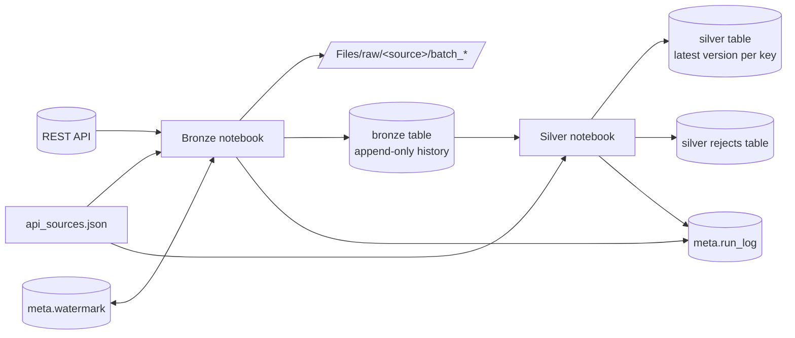

# Metadata-Driven Incremental API Ingestion in Microsoft Fabric

A practice project that ingests data from public REST APIs into a Fabric lakehouse using a **metadata-driven, incremental** pattern and a bronze/silver medallion layout. One config file describes the sources, one notebook per layer does the work, and adding a new source means adding one entry to the config, not new code.

**Sources used (public, no API key needed):**
- [GitHub Issues API](https://docs.github.com/en/rest/issues/issues) (page-number paging, nested JSON)
- [USGS Earthquake API](https://earthquake.usgs.gov/fdsnws/event/1/) (offset paging, GeoJSON, epoch-millisecond timestamps)

> This is a learning project built on sample public data. It is not a production framework.

## Architecture



| Stage | What happens | Pattern |
|---|---|---|
| Raw files | The API response is saved exactly as received, one folder per batch | Replayable without calling the API again |
| Bronze | Flattened to columns, audit columns added, appended to a Delta table | ELT: load first, keep full history |
| Silver | Newest version per key, types cast, rules validated, merged | Transform and validate before loading trusted rows |
| Control tables | `meta.watermark` (where each source stopped), `meta.run_log` (one row per run) | State lives in tables, not in code |

## Repository layout

```
.
├── README.md
├── config/
│   └── api_sources.json          # one entry per source
└── notebooks/
    ├── nb_bronze_api_ingestion.ipynb
    └── nb_silver_clean_merge.ipynb
```

## How the incremental load works

1. The bronze notebook reads the last **watermark** for the source from `meta.watermark`. On the first run there is none, so it uses `watermark_default` from the config.
2. It asks the API only for records changed since the watermark, minus a small **overlap window** (default 5 minutes). The overlap re-reads a little data on purpose so late-arriving records are not missed.
3. Each page is saved to `Files/raw/<source>/batch_<timestamp>_<id>/` before anything is parsed.
4. The batch is flattened and appended to bronze with audit columns (`ingest_ts`, `source_name`, `batch_id`, `source_file`).
5. **Only after the write succeeds** the watermark moves forward to the newest change time in the batch.
6. The silver notebook keeps the latest version of each record, so the duplicates created by the overlap, or by a record being updated twice, collapse into one row.

If a run fails, the watermark stays where it was, so the next run covers the same window again. Because silver merges on a key, repeating that window is safe.

## Design decisions

- **Land raw first.** A parsing bug never costs you data: fix the code and replay the saved batch (`replay_batch_id`).
- **Bronze is append-only.** It keeps every version of every record. Duplicates are expected and are silver's job to resolve.
- **The watermark moves last.** It is written only after bronze succeeded, with an atomic `MERGE`.
- **Idempotent writes.** Re-running a batch replaces that batch in bronze instead of duplicating it.
- **Schema checks.** A field listed in `expected_columns` that disappears from the response stops the run. A new unexpected field is reported and ignored.
- **Safe page cap.** If the page cap stops a run early and the API does not return records in watermark order (`sorted_by_watermark: false`), the run fails instead of moving the watermark past records it never fetched.
- **Retries only where they help.** 429 and 5xx responses are retried with backoff and `Retry-After`. Other 4xx errors fail immediately.
- **Rejects are kept.** Rows that fail a validation rule go to `<source>_rejects` with the rule names, never silently dropped.
- **Every run is logged,** success or failure, and failures are re-raised so an orchestrator shows the run as failed.
- **No secrets in the config.** The two sources here need none. For an authenticated API, store only a secret *name* in the config and read the value from a secret store such as Azure Key Vault.

## Setup

**Requirements:** a Microsoft Fabric workspace with a lakehouse that has **schemas enabled**.

1. Create the schemas `bronze`, `silver` and `meta` in the lakehouse.
2. Upload `config/api_sources.json` to `Files/config/` in the lakehouse.
3. Import both notebooks and attach the lakehouse as the default lakehouse.
4. In the first cell of each notebook, mark it as a **parameter cell** (cell menu, *Toggle parameter cell*).

## Running it

1. Run `nb_bronze_api_ingestion` with `source_name = "github_issues"`. The control tables are created automatically.
2. Run `nb_silver_clean_merge` with the same `source_name`.
3. Run the bronze notebook again. It should fetch almost nothing, which shows the load is incremental.
4. Repeat with `source_name = "usgs_earthquakes"`.

Checks worth running after a load:

```sql
SELECT * FROM meta.watermark;

SELECT * FROM meta.run_log ORDER BY started_at DESC LIMIT 10;

SELECT (SELECT COUNT(*) FROM bronze.github_issues) AS bronze_rows,
       (SELECT COUNT(*) FROM silver.github_issues) AS silver_rows;

SELECT COUNT(*) AS rows, COUNT(DISTINCT id) AS distinct_ids FROM silver.github_issues;
```

Bronze holding more rows than silver is expected: bronze keeps every version, silver keeps the latest.

To re-parse an existing batch without calling the API, set `replay_batch_id` to that batch's id.

## Config reference

Each entry in `api_sources.json` describes one source.

| Field | Purpose |
|---|---|
| `source_name` | Unique name, passed to the notebooks as a parameter |
| `is_active` | `1` to run, `0` to skip without deleting the entry |
| `base_url`, `endpoint` | Where to send the request |
| `extra_params` | Fixed query parameters sent on every call |
| `pagination_type` | `page` (page numbers) or `offset` (start position) |
| `page_param`, `page_size_param`, `page_size` | Names of the paging parameters and how many records per call |
| `offset_start` | First offset value, for `offset` paging (USGS counts from 1) |
| `max_pages` | Safety cap on pages per run |
| `sleep_seconds` | Pause between calls |
| `load_type` | `incremental` or `full` |
| `watermark_param` | Name of the API parameter that means "changed since" |
| `watermark_field` | Field in each record that holds its change time (dotted for nested fields) |
| `watermark_type` | `timestamp` or `epoch_ms` |
| `watermark_default` | Starting point for the first run |
| `overlap_minutes` | Re-read window before the watermark |
| `sorted_by_watermark` | `true` if the API returns records oldest-change-first, which makes the page cap safe |
| `records_path` | Where the list of records sits in the response (empty if the response is the list) |
| `expected_schema_version`, `expected_columns` | Fields the schema check requires; dotted names such as `user.login` become `user_login` |
| `bronze_folder`, `bronze_table` | Where raw files and the bronze table go |
| `merge_key` | Unique id used for the silver merge |

Cleaning and validation rules for each source are defined in the `CASTS` and `RULES` dictionaries in the silver notebook.

## Adding a new source

1. Add an entry to `api_sources.json` with the fields above.
2. Add its `CASTS` and `RULES` entries in the silver notebook.
3. Run bronze, then silver, with the new `source_name`.

No other code changes are needed.

## Testing

The core logic (config validation, paging for both styles, retry on 429, no-data handling, watermark advancement, replay, the page-cap guard, flattening, deduplication, casts and validation rules) was tested locally against a mock API and a local Spark session. The Delta-specific operations (`MERGE`, batch `DELETE`, control-table upserts) need a Fabric or Delta-enabled Spark runtime, so validate those with a first run in your lakehouse.

## Known limitations

- Silver re-reads all of bronze on every run. That is fine here; for large tables, process only batches newer than the last silver load.
- Helper functions are duplicated across the two notebooks. With more sources they would move into a shared module or library.
- The GitHub issues endpoint returns pull requests as well as issues.
- Only `page` and `offset` paging are supported (not next-link paging).
- There is no gold layer or unit-test suite in the repo yet.

## Next steps

- Orchestrate with a Fabric Data Factory pipeline: a Lookup over the config, a ForEach per source, and a Notebook activity running bronze then silver, for scheduling, retries and alerts.
- Add a gold layer (aggregates for reporting).
- Add authentication support using a secret store.
- Move shared helpers into a library and add automated tests.

## License

Add a license of your choice (for example MIT) before publishing.
